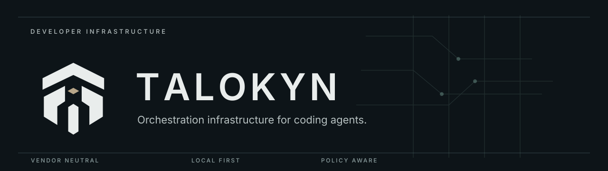

# Talokyn


**Cross-platform infrastructure for orchestrating AI coding agents.**

Talokyn is a proposed persistent local control plane that lets a supported coding agent start, supervise, message, steer when available, and recover other agent sessions. Designed for Linux, Windows and macOS.

> **Status: design/bootstrap only.** No working daemon, MCP server or provider integration has been implemented. All runtime/security/performance claims remain unverified for .NET.

## Brand and documentation

The [dark-first visual identity](docs/brand/README.md) defines guardian artwork, typography, colors and reusable design tokens.

All visual assets are proposals pending owner review. The [SVG catalog](assets/brand/README.md) contains the production source artwork.

## Documentation

The current audited design is **v1.2**:

- [Product specification](docs/design/SPEC.md)
- [Technical architecture](docs/design/ARCHITECTURE.md)
- [Verification and milestones](docs/design/VERIFICATION.md)
- [Performance and security audit](docs/design/PERFORMANCE_SECURITY_AUDIT.md)
- [Adversarial red-team review](docs/design/RED_TEAM_REPORT.md)
- [Historical designs](docs/history/README.md)

The runtime is independent of [DKSTACK](https://github.com/daniel-kindl/dkstack) and [Factory](https://github.com/daniel-kindl/factory). DKSTACK supplies contributor/agent guidance. Factory may later consume Talokyn.

## Planned architecture

- **Language:** C# 15, .NET 11
- **Process model:** single-user persistent daemon, short-lived MCP bridge and CLI
- **Agent adapters:** Codex App Server. Claude structured CLI. ACP v1 for compatible providers
- **Persistence:** SQLite plus durable event/operation journal
- **Targets:** Linux x64/ARM64, Windows x64, macOS x64/ARM64. Windows ARM64 later

These are proposed contracts, not implemented features. See [SPEC.md](docs/design/SPEC.md) for conditional provider capabilities and safety limitations.

## Development

Requires the .NET 11 SDK. JavaScript documentation checks use Node.js 24+.

```sh
dotnet restore Talokyn.slnx
dotnet build Talokyn.slnx --no-restore -warnaserror
dotnet format Talokyn.slnx --verify-no-changes --no-restore
dotnet run --project tests/Talokyn.SmokeTests/Talokyn.SmokeTests.csproj --no-restore
```

[CONTRIBUTING.md](CONTRIBUTING.md) lists the documentation checks.

There is no executable install or usage workflow yet. No releases have been published.

## Contributing and security

Read [AGENTS.md](AGENTS.md) and [CONTRIBUTING.md](CONTRIBUTING.md). Every change follows an issue, a feature branch, independent review and a gated pull request. Follow [SECURITY.md](SECURITY.md) for vulnerability reporting.

License: [MIT](LICENSE).
