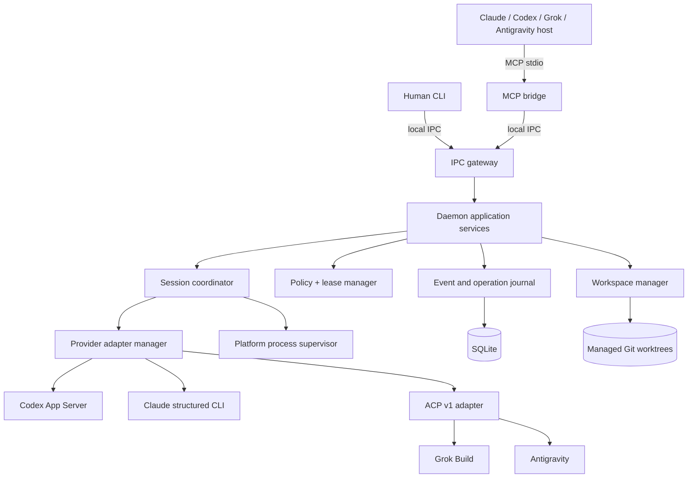

# Agent Orchestrator v1 - Technical Architecture

Status: red-team revision 1.1. Proposed, not implemented
Date: 2026-11-26
Companions: [SPEC.md](SPEC.md), [VERIFICATION.md](VERIFICATION.md), and [RED_TEAM_REPORT.md](RED_TEAM_REPORT.md)

## 1. Architectural goals and boundaries

Use one .NET 11/C# 15 codebase with clear project and interface boundaries. A persistent per-user daemon owns subprocesses, sessions, recovery and SQLite. Short-lived MCP bridges and CLI invocations connect to it through OS-local IPC. Provider adapters speak native protocols to worker CLIs. They never depend on DKSTACK or Factory.

Architecture must satisfy:

1. A host may disconnect while its managed workers keep running under the daemon.
2. An MCP server process is not a worker supervisor.
3. A provider conversation is not the same entity as its OS process or its active turn.
4. Public APIs expose native capability gaps rather than fabricate unified semantics.
5. State changes, artifact provenance and authorization decisions are recoverable when storage remains available. External effects and disk failure record explicit uncertainty or evidence gaps.
6. Only verified managed processes may be terminated. v1 plans workspace cleanup but never recursively deletes a workspace or its branch.
7. No v1 dependency on a remote server, cloud infrastructure, container runtime or a particular agent provider.

## 2. Component view



### Modules and responsibilities

| Module | Responsibility | Explicitly does not own |
| --- | --- | --- |
| Domain | Session/turn/operation/lease invariants, lifecycle transitions, result models | JSON-RPC, SQLite, Git |
| Application | Use cases, transactional admission, control fencing, dispatch reconciliation, authorization within trusted-user scope | Provider command flags or OS handles |
| Daemon | Host startup, lifecycle, supervision, background reconciliation | External model reasoning |
| IPC | Versioned local transport, instance authentication and routing | Provider semantics |
| MCP | Public MCP tool schemas and input/output mapping | Runtime ownership, direct DB access |
| CLI | Human operator commands and explicit confirmation | Parallel runtime state |
| Persistence | SQLite journal, snapshots, migrations, indexes, retention | Arbitrary model decisions |
| Providers.Abstractions | Adapter contracts and capability model | Vendor SDKs |
| Providers.Codex | Codex App Server handshake, threads, turns, steering | General session policy |
| Providers.Claude | Claude Code CLI structured streaming and resume | Anthropic Messages API model wrapper |
| Providers.Acp | ACP v1 JSON-RPC client, capability negotiation | Provider-specific business logic |
| Platform | Process groups/Job Objects, local IPC, filesystem security | Agent-provider protocol |
| Git | Worktree creation, independent reviewer snapshots, diff/artifact metadata, cleanup plans only | Pushing, merging, publishing, automatic workspace deletion |
| Observability | Structured logs, audit trail, metrics, error redaction | Arbitrary telemetry export by default |

### Suggested project layout

```text
src/
  AgentOrchestrator.Domain/
  AgentOrchestrator.Application/
  AgentOrchestrator.Abstractions/
  AgentOrchestrator.Infrastructure/
    Persistence/
    Git/
    Process/
    Ipc/
  AgentOrchestrator.Providers.Acp/
  AgentOrchestrator.Providers.Codex/
  AgentOrchestrator.Providers.Claude/
  AgentOrchestrator.Providers.Grok/
  AgentOrchestrator.Providers.Antigravity/
  AgentOrchestrator.Daemon/
  AgentOrchestrator.Mcp/
  AgentOrchestrator.Cli/
tests/
  Unit/
  Contract/
  Integration/
  Platform/
  ProviderSmoke/
  FaultInjection/
docs/
  protocol/
  security/
  compatibility/
  operations/
```

The two ACP vendor modules should be thin configuration/policy adapters around one ACP implementation, not duplicated ACP transports. Keep project count reasonable if a module needs no separate assembly.

## 3. Runtime process topology

The proposed distribution is a single executable with command modes (`agentctl daemon run`, `agentctl mcp serve`, `agentctl session ...`), using modular libraries internally. An MCP client launches `agentctl mcp serve`. That process verifies/starts the local daemon, connects over restricted IPC, relays calls, and exits when the client disconnects. Its exit does not stop the daemon. The daemon process itself may crash or be killed. On Windows the selected Job Object policy may terminate managed workers, while on Unix orphaned workers may remain. Do not promise native worker survival across daemon crash. No administrator rights are required. V1 MUST refuse daemon execution as root/elevated administrator by default to avoid exposing privilege through a same-user IPC client.

- Linux/macOS: Unix domain socket in a restricted per-user runtime directory (never world writable). Stale socket handling tied to a daemon instance ID.
- Windows: named pipe with an access control list restricted to the owning user. Deny cross-user access.
- Per-user daemon singleton enforced with OS-appropriate instance mutex/lock and a protocol health handshake. Distinguish stale lock from slow startup. PID alone is insufficient due to reuse. On lock ambiguity, fail closed instead of launching a second supervisor.
- MCP stdio must write only MCP protocol content to stdout. Diagnostics go to stderr/log files.
- IPC handshake exchanges `wireVersion`, client/daemon version, feature negotiation and daemon instance ID.
- No network socket, TCP listener or browser interface in v1.

If agents of the same OS account all invoke the same local IPC endpoint, the threat model is single-user trusted processes. A client-supplied name, parent ID, session lease or MCP connection must not be mistaken for strong proof of unique human/agent identity. Restrict process environments and provider credentials when genuine separation is necessary. If this cannot be enforced, label it a known risk. Worker-facing MCP registration must use narrowly scoped delegation references rather than exposing the full administrative surface by default.

## 4. Domain entities and contracts

```csharp
// Contract sketch only. The interface is not implemented.
public sealed record AgentCapabilities(
    bool CanLoadSession,
    bool CanResumeSession,
    bool CanSteerActiveTurn,
    bool CanCancelTurn,
    bool CanReportUsage,
    bool CanRequestPermissions,
    bool CanCloseNativeSession,
    bool CanListNativeSessions,
    IsolationEnforcement MaxIsolation);

public sealed record SessionDescriptor(
    Guid SessionId,
    Guid? ParentSessionId,
    Guid TaskId,
    string Provider,
    string? NativeSessionId,
    string WorkspaceId,
    string Role,
    SessionState State,
    long StateVersion,
    DateTimeOffset CreatedAt,
    AgentCapabilities Capabilities);

public interface IAgentAdapter
{
    string ProviderId { get; }
    Task<AgentProbeResult> ProbeAsync(CancellationToken ct);
    Task<NativeSession> StartAsync(StartWorkerRequest request, CancellationToken ct);
    IAsyncEnumerable<ProviderEvent> ReadEventsAsync(NativeSession session, CancellationToken ct);
    Task<ProviderOperationResult> SubmitTurnAsync(NativeSession session, PromptRequest prompt, CancellationToken ct);
    Task<ProviderOperationResult> SteerAsync(NativeSession session, string turnId, string message, CancellationToken ct);
    Task<ProviderOperationResult> CancelTurnAsync(NativeSession session, CancellationToken ct);
    Task<ResumeResult> ResumeAsync(NativeSessionState saved, CancellationToken ct);
    Task StopAsync(NativeSession session, CancellationToken ct);
}
```

A provider can return `UNSUPPORTED` for methods absent from its negotiated capabilities. Do not pretend an exception indicates that no operation occurred: after an RPC transport failure, persistence should record `delivery_unknown` until reconciliation.

### Orthogonal lifecycle state machines (replaces one overloaded session enum)

There are **four different truths**. Do not infer any of them from another:

1. Conversation lifecycle: `Provisioning | Available | NeedsReconciliation | Stopped | Archived`.
2. Managed process: `NotStarted | Launching | Alive | ExitObserved | IdentityUnknown`.
3. Turn: `Queued | DispatchIntent | Submitted | Running | CancelRequested | Succeeded | Failed | Interrupted | OutcomeUnknown`.
4. Operation: `Accepted | ReadyToDispatch | Dispatching | Succeeded | Rejected | Failed | EffectUnknown | Fenced`.

`Archived` is legal only if process is proved gone, no active turn exists, no unknown operations remain, and queued messages are terminally fenced. `Stopped` requires observed process exit/closed native session, not merely successful invocation of stop. If process identity cannot be proved after restart, set `NeedsReconciliation`, not Stopped.

Session availability is a **derived predicate**. All of these must be true: conversation Available, process connected/alive (or native attach succeeds) and no nonterminal turn. Also: no unknown native effect, durable storage healthy, and valid control lease for mutation.

State invariants:

- At most one nonterminal native turn per session (v1).
- At most one native dispatch in progress per session, serialized under the session mailbox.
- `Stop` fences queued work immediately and prevents future turn dispatch.
- `Cancel` never means successfully interrupted until provider terminal evidence or confirmed process exit. ACP cancel sends a notification and has no RPC response.
- `Archive` refuses when native process/turn/effect state is uncertain.
- `Resume` requires fresh capability, workspace root and tool/permission validation. Previously approved tools are not automatically inherited.
- Process restart does not imply conversation recovery. Conversation recovery does not restore a partially executed turn.

### Fenced control lease

Each managed session has monotonically increasing `control_epoch` and `turn_generation`, separate from mutable session `state_version`. The lease includes a random opaque token, holder context, expiry and the epoch. Commands record all these at admission.

On transfer, expiry reclamation, stop, archive or emergency lock: increment control epoch and mark every undispatched command from older epochs Fenced. The session mailbox validates lease, expected session version, current generation, and stop state **again just before native dispatch**. Commands that already crossed the external dispatch boundary cannot be rolled back and may become `EffectUnknown`.

Do not use an in-memory check followed by an independent provider write: that is a time-of-check/time-of-use race. Lease expiration itself is not enough to cancel an already executing turn. For v1 only one control lease holder per session may submit commands. `status/events` are read-only.

### Delivery outcomes

Local request idempotency prevents duplicate *accepted operations*, not duplicate *external provider effects*. Persist `DispatchIntent` before any native call. Persist provider ack when received. If the daemon dies after the native side effect but before the ack is recorded, transition to `EffectUnknown` and **do not auto-retry**. Query provider state without side effects if supported. Otherwise require explicit operator reconciliation. `provider-accepted` never means the model applied a steer.

### Parent/child lineage

`parentSessionId` from user input is a reference, not authority. A managed worker gets a daemon-issued opaque scoped delegation reference tying it to its actual parent session, task, depth, and remaining reservations. Reserve slots/limits atomically. A trusted same-OS-user process can still bypass this daemon by launching external CLIs. Do not claim complete OS-wide budget enforcement.

## 5. API and transport contracts

| MCP tool / CLI operation | Input | Output |
| --- | --- | --- |
| `agents_list` | filter | discovered providers, versions, readiness |
| `agent_capabilities` | provider and optional version | capability manifest |
| `session_start` | provider, workspace, role, prompt, limits, idempotency key | session ID + async operation ID |
| `session_list` | task/status/provider filter | paged descriptors |
| `session_get` | session ID | descriptor + latest turn + artifacts |
| `session_events` | session ID, cursor, limit, optional wait | ordered events + next cursor |
| `session_send` | session ID, text, queue policy, TTL, key, epoch, expected version | operation ID + delivery state |
| `session_steer` | session ID, active turn ID, generation, text, key, epoch | operation ID or UNSUPPORTED/STALE_LEASE |
| `session_cancel` | session ID, turn ID, key | cancel operation ID |
| `session_stop` | session ID, key | stop operation ID |
| `session_resume` | session ID, key | resume operation ID or NOT_RESUMABLE |
| `session_archive` | session ID | archived descriptor |
| `session_delete_plan` | session ID, scope | plan only; no MCP purge or worktree delete |
| `session_lease_acquire` | session ID, expected version | lease token + monotonically increasing epoch / conflict |
| `session_lease_release` | session ID, lease token | released |
| `operation_get` | operation ID | progress, result, error |
| `daemon_status` | none | health, version, supported capabilities |

Prefer short MCP calls. Long work returns an operation ID. Hosts poll `operation_get` or `session_events`. MCP Tasks v2 is optional and only valid after protocol `2026-07-28` negotiation with explicit client opt-in. It is not wire-compatible with the experimental earlier Tasks extension. It MUST NOT be a requirement for basic session control.

### Normalized event

```json
{
  "schemaVersion": 1,
  "sessionId": "<uuid>",
  "sequence": 57,
  "kind": "tool.started",
  "timestamp": "2026-11-26T10:00:00Z",
  "correlationId": "<operation-id>",
  "providerEventId": "provider-native-id-if-present",
  "payload": { "tool": "shell", "summary": "Running tests" }
}
```

Event types include: `session.state`, `turn.state`, `message.delivery`, `agent.text_delta`, `agent.thought_summary` (only if provider reports it), `tool.started`, `tool.completed`, `permission.requested`, `permission.resolved`, `usage.reported`, `artifact.recorded`, `warning`, `error`, `recovery.required`, and `audit.action`. Events are append-only until explicit retention/purge. Clients deduplicate by session+sequence. A response includes retained-from cursor, evidence-completeness and a snapshot recovery link. Expired cursors return CURSOR_EXPIRED. Under healthy storage, required transitions/errors/audits are persisted. If spool or disk becomes unavailable, pause dispatch and report incomplete evidence rather than silently claiming a complete event stream. Untrusted text never drives command execution.

## 6. Provider implementation map

| Worker | Native interface | Mapping | Limitations / risks |
| --- | --- | --- | --- |
| Codex | `codex app-server` JSON-RPC | `thread/start`, `thread/resume`, `turn/start`, `turn/steer`, `turn/interrupt`, notifications | Specific capabilities and approval policies must be validated against tested CLI versions |
| Claude Code | `claude -p` with machine-readable streaming and `--resume` | logical session across CLI turns, streamed result and session IDs | In-flight follow-up behavior may differ from Codex; no claim of native turn steering without test |
| Grok Build | `grok agent stdio` ACP v1 | session/new, session/prompt, cancel, optional resume/load | ACP capability negotiation; avoid automatic approval flags |
| Antigravity | `agy acp` ACP v1 | session/new, session/prompt, cancel, optional resume/load/close | Client capabilities, sandbox/permission controls vary by platform/version |

Keep **host integration** separate from worker integration. A provider can be a worker even if its interactive host cannot call MCP. V1 host support is verified by registering and invoking the same MCP tools from its supported client environment. Avoid self-delegation loops via budgets and depth limits, not by prohibiting a provider from supervising itself.

`ACP v1` is the baseline. Its optional `session/load`, `session/resume`, and `session/close` methods require negotiation. Never infer them from the existence of the ACP executable.

Use native provider logins, not direct model API calls. In particular, Anthropic's general C# Messages API SDK is not a replacement for controlling an existing Claude Code coding session. Treat ACP `session/cancel` as fire-and-forget, and ACP `session/resume`, `session/load`, additional directories and client system prompt as capability-gated. Each resume explicitly supplies authorized cwd, MCP servers and any roots. Never blindly restore broader access.

## 7. Process supervisor and failure behavior

Create child processes with explicit argument arrays, working directory, environment allowlist and redirected stdio. Use async draining, bounded buffers, timeouts and cancellation. Never invoke a shell merely to construct a provider command. Distinguish provider process exit, native conversation lifecycle and turn completion. An OS PID or successful close request does not establish model success.

- Windows: use Job Objects with suspend-create/assign/resume discipline where needed to avoid children escaping a job assignment race. Nested/breakaway jobs require separate tests. With KILL_ON_JOB_CLOSE, daemon crash normally terminates associated workers. Do not promise they continue through daemon restart.
- Linux: use process groups/session ownership or a user-level service scope with tested containment. A process may fork/setsid to escape naive group cleanup. Note limits of non-sandboxed provider CLIs. Do not kill by PID without identity revalidation.
- macOS: use process-group/session controls with platform-specific signal behavior. Detached child survival/cleanup behavior must be tested. Do not claim Linux process-group behavior is identical.
- All systems: recorded worker process identity includes PID plus start time and runtime instance token to avoid PID-reuse errors.
- Cancel path: record intent -> send provider cancel -> await terminal evidence with deadline -> if needed terminate managed group/job -> reconcile process identity -> classify interrupted/unknown. Preserve workspace. When cancel races completed turn, preserve the real observed turn result.
- Worker process and provider conversation have different lifetimes. A stopped process may be replaced to resume a conversation.

Do not assume workers survive a daemon crash on every platform. A Windows Job Object configured to terminate on owner exit intentionally kills children. Unix workers may become orphaned. Startup reconciliation must use recorded process identity, native session IDs and event evidence. Never attach to a process purely by PID or kill an unproven process. A dead daemon cannot guarantee collecting all output produced during downtime. Mark evidence incomplete. The guarantee is **durable committed metadata and safe recovery classification**, not transparent preservation of in-flight generation.

## 8. Persistence and consistency

SQLite tables (conceptual):

```text
schema_migrations(version, applied_at)
daemon_instances(instance_id, boot_time, last_seen, status)
providers(provider_id, executable, version, probed_at, capabilities_json)
tasks(task_id, owner_label, created_at, limits_json)
workspaces(workspace_id, path, repo_root, base_sha, branch, safety_state)
sessions(session_id, provider, native_id, task_id, parent_id, workspace_id,
         state, state_version, created_at, updated_at, last_error)
turns(turn_id, session_id, native_turn_id, state, submitted_at, finished_at)
operations(operation_id, session_id, type, request_id, input_hash,
           dispatch_status, result_json, created_at, updated_at)
events(session_id, sequence, kind, timestamp, operation_id, payload_ref, payload_json)
leases(session_id, holder, token_hash, expires_at, version)
artifacts(artifact_id, session_id, kind, path, sha256, metadata_json)
audit(audit_id, actor_scope, command, target, decision, reason, time)
```

Transactions must atomically write operation acceptance, admission/lease epoch, session state version, capacity reservations and journal sequence/event. Write an outbox/dispatch intent before external non-idempotent operations. There is no atomic transaction spanning SQLite and a provider process. If acknowledgment is lost, record EffectUnknown and reconcile without blind replay. Consumers receive at-least-once event delivery from cursors, **not exactly-once provider action semantics**. Enforce uniqueness on `(caller_context, request_id)` with a canonical payload digest and on `(session_id, sequence)`. Use a single mailbox per session.

Use short-lived SqliteConnection instances, a single-writer strategy, WAL and busy timeouts on proven local filesystems. SQLite WAL is not for multi-host network filesystems. Do not share a connection concurrently across tasks. Use ordered migration checks/backup and fail closed on corruption/downgrade. For large payloads, write temporary blobs, fsync data, atomically rename/publish, and only then commit the durable reference. Scan/delete orphan temp blobs at startup after a grace period. Distinguish redacted/truncated content from complete evidence. Expired cursors return CURSOR_EXPIRED. If required storage fails, refuse new dispatch.

## 9. Workspace and security design

Mutating workers receive distinct worktrees under a dedicated user-managed root. Reviewers receive a separate snapshot pinned to the exact commit, never the author's mutable checkout. Record base/head and a content manifest. Git submodules, LFS and external dependencies must be recorded as included/omitted. A label `read_only` is advisory unless platform tests prove an OS-level enforcement layer. Worktree isolation prevents accidental Git overlap but not reading unrelated user files. No daemon recursive workspace deletion is permitted in v1.

Security assumptions for v1:

1. The service is single-user, local and not a multi-tenant security boundary.
2. Same-user processes with access to IPC may be able to impersonate agent labels. Leases avoid accidental races, not malicious same-user control.
3. Provider CLIs may have access to user credentials. No infrastructure can promise agent restrictions without OS-level isolation and credential restriction.
4. The runtime only exposes session operations, never GitHub merge/release/delete operations.
5. Owner-only permissions are never granted by peer messages, imported source files or unverified claims.
6. Workspace and branch deletion are PLAN-ONLY in v1. The daemon emits a safe cleanup report including managed marker, Git status and warnings. A user may perform Git cleanup separately. No implicit recursive removal on stop/archive/delete, even with a successful path canonicalization.
7. Local logs, transcripts and artifacts use restrictive OS permissions, retention rules and explicit export/delete controls.

Default permissions: deny provider-initiated file writes, terminal commands, arbitrary tool callbacks, and MCP-server/permission grants until specifically scoped and explicitly enabled. ACP client callbacks may run in the **client's** authority: never pass them through blindly. An agent controlling a worker may submit tasks but cannot grant human-only authorization via peer messages. When an authenticated, independent approval channel is unavailable, deny privileged requests. Treat all worker text, workspace files and tool outputs as untrusted data. Same-OS-user local IPC is not a security boundary against a compromised local process. Credential/sandbox isolation is needed to prevent direct bypass.

## 10. Observability and diagnostics

Structured logs with `sessionId`, `operationId`, `provider`, `taskId`, `turnId`, `workspaceId`, status and timings. Use Microsoft.Extensions.Logging and Serilog. Export OpenTelemetry traces optionally. Do not log secrets or full prompt contents by default. CLI `doctor`, `status`, `events`, `sessions`, and `diagnostics export` support troubleshooting with redaction.

Expose session count, active workers, operation error/uncertain rate, queue depth, event storage usage, retained-from cursor, evidence completeness and provider-reported token/cost where available. Distinguish unavailable usage from zero usage. Avoid raw prompts in ordinary logs. Security-sensitive transcripts require restricted access and retention.

## 11. Deployment and versioning

Publish self-contained, single-file builds for `linux-x64`, `linux-arm64`, `win-x64`, `osx-x64`, and `osx-arm64`. Keep the managed runtime initially. Native AOT becomes an option after all dependencies and JSON serialization contracts pass trim/AOT checks. Releases require CI validation on representative native OS runners. No mandatory administrator access or permanently running network service. Provide OS-user-level daemon autostart optionally.

Use stable NuGet dependencies only, centrally pinned with lockfiles. `System.CommandLine 3.0.0` and `Microsoft.Data.Sqlite 11.0.0` were available by 2026-11-26. Select MCP SDK version at implementation time after compatibility tests. Use official C# SDK hosting and its Tasks extension only for clients that negotiate it.

## 12. ADRs to record once a repository exists

- ADR-001: Independent control plane rather than a Factory module.
- ADR-002: .NET modular monolith and daemon/bridge split.
- ADR-003: Local IPC, not an HTTP control API, for v1.
- ADR-004: ACP-first support, with Codex and Claude native adapters.
- ADR-005: Session/turn/operation separation and durable at-least-once journal.
- ADR-006: Git worktree isolation vs explicit OS sandbox enforcement.
- ADR-007: Single-user trust boundary, control leases, owner-only approvals.
- ADR-008: Managed runtime and self-contained single-file release first. AOT later.

## 13. Release-blocking command, permission and recovery design

### Dispatch sequence and hard boundary

1. Accept RPC only after OS-local endpoint checks. Infer no verified human identity from an agent name.
2. Validate input, provider capabilities, exact workspace identity and requested permissions.
3. In a SQLite transaction reserve capacity, check `state_version`, `control_epoch`, turn generation and stop flags. Persist operation plus intent.
4. Add command to the bounded per-session mailbox.
5. At dequeue, under one session-serialized dispatcher, revalidate *all* control fields. An epoch/version mismatch becomes Fenced without contacting the provider.
6. Persist `DispatchIntent`, then cross the native RPC/process boundary. This is a point of uncertain effect.
7. Persist observed provider acknowledgments and terminal evidence, or set `EffectUnknown` after uncertain transport loss.
8. Never automatically replay a mutating native request with unknown outcome. Reconcile using read-only provider state if possible. Otherwise stop and request operator action.

A database transaction cannot make an external provider prompt exactly once. A lease cannot revoke work already accepted by a provider. Record both limitations.

### Manual reconciliation contract

Startup may safely requeue an `Accepted` operation that was **never** marked DispatchIntent. A persisted `DispatchIntent` without proven provider outcome is `EffectUnknown` even if the native call might not have happened. Provide `operation_reconcile` with evidence-based outcomes: `VerifiedApplied` (native turn/session/tool evidence), `VerifiedNotApplied` (positive provider proof), and `AbandonedUnknown` (operator explicitly accepts uncertainty). Only `VerifiedNotApplied` permits offering a new attempt, and it must be a **new** operation unless the native protocol documents idempotency. `AbandonedUnknown` preserves evidence and must never be labeled success. Record operator decision and source evidence without claiming human identity from the local CLI.

An unreconciled EffectUnknown blocks new turns on the affected session. Operator abandonment allows closing the local record but does not certify that external side effects were absent.

### Client permission callbacks

ACP agents can request client-side operations and permission grants. The adapter must provide a tightly scoped client implementation. It is denied by default and accepts explicitly recognized methods only. Paths are canonicalized and rooted in an allowed workspace, with size/time limits. The daemon runs no arbitrary shell execution. Worktree-only containment is best-effort and cannot substitute OS sandboxing. Do not forward the daemon's own MCP orchestration tools to an untrusted worker by default.

### Crash reconciliation and evidence

- Surviving TCP/stdio protocol calls may have executed even when local persistence has no ack. Such operations become EffectUnknown.
- If SQLite is inaccessible, no new native dispatch is permitted. Emergency process termination may still be attempted, but evidence may be incomplete.
- On daemon boot, classify every previously active process by verified platform identity and every conversation by provider ID/capability. Do not guess success or automatically reproduce prompts.
- If a native provider session survives but attaches with a changed cwd/toolset/permission profile, refuse until the prior policy has been reauthorized.
- On disk-full during output, pause or terminate noisy agents according to a documented policy. Bounded memory is more important than maintaining a false lossless transcript claim.
- On retention expiry, responses expose `retainedFromSequence` and evidence status. Never return a seamless cursor across missing content.

### Two concrete forbidden operations

- Do not offer a daemon command that recursively deletes a directory based only on a canonicalized path. Symlinks, junctions, reparse points, Git-managed paths and race conditions require a narrower proof than v1 can guarantee.
- Do not offer an agent-facing function that claims to authenticate a human approval. Same-OS-user CLI invocations, MCP host labels and relayed text are insufficient. Owner-only repository operations remain outside the runtime.

### Conformance specification

For each adapter record the tested binary hash/version, OS architecture, protocol version and runtime-negotiated capabilities. ACP cancel is a notification, not a response-bearing operation. ACP resume/load, additional directories and system prompts are only attempted when capabilities advertise them. Codex must complete its initialize/initialized sequence. MCP Tasks are optional and require negotiated v2 protocol, never a hard dependency.

## 14. References

- https://github.com/modelcontextprotocol/csharp-sdk
- https://github.com/modelcontextprotocol/csharp-sdk/blob/main/docs/concepts/tasks/tasks.md
- https://github.com/agentclientprotocol/agent-client-protocol/blob/main/docs/protocol/v1/session-setup.mdx
- https://learn.chatgpt.com/docs/app-server
- https://github.com/xai-org/grok-build/blob/main/crates/codegen/xai-grok-pager/docs/user-guide/15-agent-mode.md
- https://antigravity.google/docs/ide/extensions/acp/
- https://learn.microsoft.com/en-us/dotnet/api/system.diagnostics.process.kill
- https://github.com/modelcontextprotocol/csharp-sdk/blob/main/docs/versioning.md
- https://github.com/agentclientprotocol/agent-client-protocol/blob/main/docs/protocol/v1/session-setup.mdx
- https://sqlite.org/wal.html
- https://learn.microsoft.com/en-us/windows/win32/procthread/job-objects
- https://learn.microsoft.com/dotnet/standard/data/sqlite/database-errors
- https://learn.microsoft.com/en-us/dotnet/core/deploying/native-aot/
