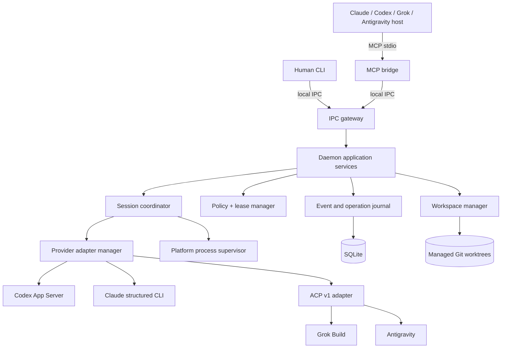
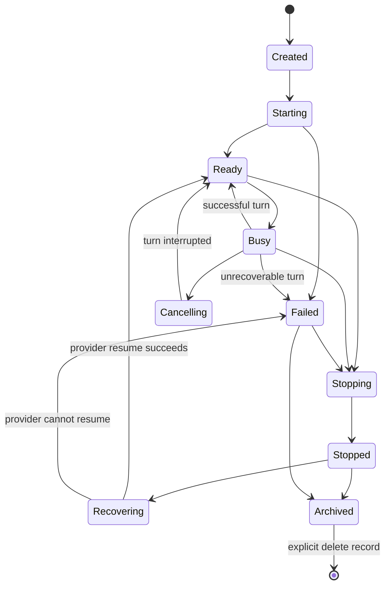

# Agent Orchestrator v1 - Technical Architecture

Status: proposed, not implemented
Date: 2026-11-26
Companion: [SPEC.md](SPEC.md) and [VERIFICATION.md](VERIFICATION.md)

## 1. Architectural goals and boundaries

Use one .NET 11/C# 15 codebase with clear project and interface boundaries. A persistent per-user daemon owns subprocesses, sessions, recovery and SQLite. Short-lived MCP bridges and CLI invocations connect to it through OS-local IPC. Provider adapters speak native protocols to worker CLIs. They never depend on DKSTACK or Factory.

Architecture must satisfy:

1. A host may disconnect while its managed workers keep running under the daemon.
2. An MCP server process is not a worker supervisor.
3. A provider conversation is not the same entity as its OS process or its active turn.
4. Public APIs expose native capability gaps rather than fabricate unified semantics.
5. State changes, artifact provenance and authorization decisions are recoverable and auditable.
6. Only managed resources may be terminated or deleted, using a verified resource identity.
7. No v1 dependency on a remote server, cloud infrastructure, container runtime or a particular agent provider.

## 2. Component view



### Modules and responsibilities

| Module | Responsibility | Explicitly does not own |
| --- | --- | --- |
| Domain | Session/turn/operation/lease invariants, lifecycle transitions, result models | JSON-RPC, SQLite, Git |
| Application | Use cases, command validation, orchestration and authorization | Provider command flags or OS handles |
| Daemon | Host startup, lifecycle, supervision, background reconciliation | External model reasoning |
| IPC | Versioned local transport, instance authentication and routing | Provider semantics |
| MCP | Public MCP tool schemas and input/output mapping | Runtime ownership, direct DB access |
| CLI | Human operator commands and explicit confirmation | Parallel runtime state |
| Persistence | SQLite journal, snapshots, migrations, indexes, retention | Arbitrary model decisions |
| Providers.Abstractions | Adapter contracts and capability model | Vendor SDKs |
| Providers.Codex | Codex App Server handshake, threads, turns, steering | General session policy |
| Providers.Claude | Claude Code CLI structured streaming and resume | Anthropic Messages API model wrapper |
| Providers.Acp | ACP v1 JSON-RPC client, capability negotiation | Provider-specific business logic |
| Platform | Process groups/Job Objects, local IPC, filesystem security | Agent-provider protocol |
| Git | Worktree creation, snapshot/diff/artifact metadata, safe cleanup plans | Pushing, merging, publishing |
| Observability | Structured logs, audit trail, metrics, error redaction | Arbitrary telemetry export by default |

### Suggested project layout

```text
src/
  AgentOrchestrator.Domain/
  AgentOrchestrator.Application/
  AgentOrchestrator.Abstractions/
  AgentOrchestrator.Infrastructure/
    Persistence/
    Git/
    Process/
    Ipc/
  AgentOrchestrator.Providers.Acp/
  AgentOrchestrator.Providers.Codex/
  AgentOrchestrator.Providers.Claude/
  AgentOrchestrator.Providers.Grok/
  AgentOrchestrator.Providers.Antigravity/
  AgentOrchestrator.Daemon/
  AgentOrchestrator.Mcp/
  AgentOrchestrator.Cli/
tests/
  Unit/
  Contract/
  Integration/
  Platform/
  ProviderSmoke/
  FaultInjection/
docs/
  protocol/
  security/
  compatibility/
  operations/
```

The two ACP vendor modules should be thin configuration/policy adapters around one ACP implementation, not duplicated ACP transports. Keep project count reasonable if a module needs no separate assembly.

## 3. Runtime process topology

The proposed distribution is a single executable with command modes (`agentctl daemon run`, `agentctl mcp serve`, `agentctl session ...`), using modular libraries internally. An MCP client launches `agentctl mcp serve`. That process verifies/starts the local daemon, connects over a restricted IPC endpoint, relays calls, and exits when the client disconnects. The daemon remains alive until explicit stop or user-service shutdown. Native per-user startup integration is optional. No administrator rights are needed for normal operation.

- Linux/macOS: Unix domain socket in a restricted per-user runtime directory (never world writable). Stale socket handling tied to a daemon instance ID.
- Windows: named pipe with an access control list restricted to the owning user. Deny cross-user access.
- Per-user daemon singleton enforced with OS-appropriate instance mutex/lock plus a protocol health handshake. PID alone is insufficient due to reuse.
- MCP stdio must write only MCP protocol content to stdout. Diagnostics go to stderr/log files.
- IPC handshake exchanges `wireVersion`, client/daemon version, feature negotiation and daemon instance ID.
- No network socket, TCP listener or browser interface in v1.

If agents of the same OS account all invoke the same local IPC endpoint, the threat model is single-user trusted processes. A client-supplied name or session control lease must not be mistaken for strong proof of unique agent identity.

## 4. Domain entities and contracts

```csharp
// Contract sketch only. The interface is not implemented.
public sealed record AgentCapabilities(
    bool CanLoadSession,
    bool CanResumeSession,
    bool CanSteerActiveTurn,
    bool CanCancelTurn,
    bool CanReportUsage,
    bool CanRequestPermissions,
    bool CanCloseNativeSession,
    bool CanListNativeSessions,
    IsolationEnforcement MaxIsolation);

public sealed record SessionDescriptor(
    Guid SessionId,
    Guid? ParentSessionId,
    Guid TaskId,
    string Provider,
    string? NativeSessionId,
    string WorkspaceId,
    string Role,
    SessionState State,
    long StateVersion,
    DateTimeOffset CreatedAt,
    AgentCapabilities Capabilities);

public interface IAgentAdapter
{
    string ProviderId { get; }
    Task<AgentProbeResult> ProbeAsync(CancellationToken ct);
    Task<NativeSession> StartAsync(StartWorkerRequest request, CancellationToken ct);
    IAsyncEnumerable<ProviderEvent> ReadEventsAsync(NativeSession session, CancellationToken ct);
    Task<ProviderOperationResult> SubmitTurnAsync(NativeSession session, PromptRequest prompt, CancellationToken ct);
    Task<ProviderOperationResult> SteerAsync(NativeSession session, string turnId, string message, CancellationToken ct);
    Task<ProviderOperationResult> CancelTurnAsync(NativeSession session, CancellationToken ct);
    Task<ResumeResult> ResumeAsync(NativeSessionState saved, CancellationToken ct);
    Task StopAsync(NativeSession session, CancellationToken ct);
}
```

A provider can return `UNSUPPORTED` for methods absent from its negotiated capabilities. Do not pretend an exception indicates that no operation occurred: after an RPC transport failure, persistence should record `delivery_unknown` until reconciliation.

### Session state machine



On daemon crash/restart, mark any uncertain in-flight operation `recovery_required`. Reconcile worker native state, OS identity and provider IDs. A running turn may be irrecoverable even when conversation resume is supported. Never auto-replay potentially non-idempotent prompts until state is reconciled.

### Turn state machine

`Queued -> Submitted -> Running -> Completed|Failed|Interrupted`, plus `DeliveryUnknown` when the daemon cannot establish whether the provider accepted submission. Turn IDs are provider-native when available and runtime-generated otherwise. One in-flight turn per session by default.

### Operation state machine

`Accepted -> Dispatching -> Succeeded|Rejected|Failed|Unknown`. `Unknown` resolves through explicit reconciliation, not automatic duplicate dispatch. Every mutation takes an idempotency key and expected session version where relevant.

### Control lease

A control lease has session ID, holder reference, lease token, expiration time and state version. Mutating actions must present the current lease or use an explicit human/operator override. Acquisition after lease expiry is recorded. Leases prevent accidental concurrent steering. They are not a same-user security boundary.

## 5. API and transport contracts

| MCP tool / CLI operation | Input | Output |
| --- | --- | --- |
| `agents_list` | filter | discovered providers, versions, readiness |
| `agent_capabilities` | provider and optional version | capability manifest |
| `session_start` | provider, workspace, role, prompt, limits, idempotency key | session ID + async operation ID |
| `session_list` | task/status/provider filter | paged descriptors |
| `session_get` | session ID | descriptor + latest turn + artifacts |
| `session_events` | session ID, cursor, limit, optional wait | ordered events + next cursor |
| `session_send` | session ID, text, explicit queue policy, key | operation ID + delivery state |
| `session_steer` | session ID, active turn ID, text, key | operation ID or UNSUPPORTED |
| `session_cancel` | session ID, turn ID, key | cancel operation ID |
| `session_stop` | session ID, key | stop operation ID |
| `session_resume` | session ID, key | resume operation ID or NOT_RESUMABLE |
| `session_archive` | session ID | archived descriptor |
| `session_delete` | session ID, explicit scope | deletion plan / confirmation requirement |
| `session_lease_acquire` | session ID, prior version | lease token / conflict |
| `session_lease_release` | session ID, lease token | released |
| `operation_get` | operation ID | progress, result, error |
| `daemon_status` | none | health, version, supported capabilities |

Prefer under-30-second MCP calls. Long work returns an operation ID. A host polls `operation_get` or `session_events`. MCP Tasks can be added opportunistically after host capability negotiation, never as the only interaction path.

### Normalized event

```json
{
  "schemaVersion": 1,
  "sessionId": "<uuid>",
  "sequence": 57,
  "kind": "tool.started",
  "timestamp": "2026-11-26T10:00:00Z",
  "correlationId": "<operation-id>",
  "providerEventId": "provider-native-id-if-present",
  "payload": { "tool": "shell", "summary": "Running tests" }
}
```

Event types include: `session.state`, `turn.state`, `message.delivery`, `agent.text_delta`, `agent.thought_summary` (only if provider reports it), `tool.started`, `tool.completed`, `permission.requested`, `permission.resolved`, `usage.reported`, `artifact.recorded`, `warning`, `error`, `recovery.required`, and `audit.action`. Events are append-only. Clients deduplicate by session+sequence. The daemon may coalesce progress events, but must not silently lose state transitions, errors, audit entries or artifact references.

## 6. Provider implementation map

| Worker | Native interface | Mapping | Limitations / risks |
| --- | --- | --- | --- |
| Codex | `codex app-server` JSON-RPC | `thread/start`, `thread/resume`, `turn/start`, `turn/steer`, `turn/interrupt`, notifications | Specific capabilities and approval policies must be validated against tested CLI versions |
| Claude Code | `claude -p` with machine-readable streaming and `--resume` | logical session across CLI turns, streamed result and session IDs | In-flight follow-up behavior may differ from Codex; no claim of native turn steering without test |
| Grok Build | `grok agent stdio` ACP v1 | session/new, session/prompt, cancel, optional resume/load | ACP capability negotiation; avoid automatic approval flags |
| Antigravity | `agy acp` ACP v1 | session/new, session/prompt, cancel, optional resume/load/close | Client capabilities, sandbox/permission controls vary by platform/version |

Keep **host integration** separate from worker integration. A provider can be a worker even if its interactive host cannot call MCP. V1 host support is verified by registering and invoking the same MCP tools from its supported client environment. Avoid self-delegation loops via budgets and depth limits, not by prohibiting a provider from supervising itself.

`ACP v1` is the baseline. Its optional `session/load`, `session/resume`, and `session/close` methods require negotiation. Never infer them from the existence of the ACP executable.

Use native provider logins, not direct model API calls. In particular, Anthropic's general C# Messages API SDK is not a replacement for controlling an existing Claude Code coding session.

## 7. Process supervisor and failure behavior

Create child processes with explicit argument arrays, working directory, environment allowlist and redirected stdio. Use async draining, bounded buffers, timeouts and cancellation. Never invoke a shell merely to construct a provider command.

- Windows: use Job Objects and explicit process creation/assignment discipline where process-tree guarantees are required. Test descendants that spawn and exit rapidly.
- Linux: use process groups/session ownership or a user-level service scope, not PID-only cleanup.
- macOS: use process-group/session controls with platform-specific signal behavior.
- All systems: recorded worker process identity includes PID plus start time and runtime instance token to avoid PID-reuse errors.
- Cancel path: provider protocol cancel -> grace period -> terminate managed group/job -> mark outcome. Preserve workspace.
- Worker process and provider conversation have different lifetimes. A stopped process may be replaced to resume a conversation.

Do not assume workers survive a daemon crash on every platform. A Windows Job Object configured to terminate on owner exit intentionally kills children. Unix workers may become orphaned. Record uncertain state, reconcile and resume provider conversations where possible. The guarantee is **durable metadata and safe recovery classification**, not transparent preservation of any in-flight token generation.

## 8. Persistence and consistency

SQLite tables (conceptual):

```text
schema_migrations(version, applied_at)
daemon_instances(instance_id, boot_time, last_seen, status)
providers(provider_id, executable, version, probed_at, capabilities_json)
tasks(task_id, owner_label, created_at, limits_json)
workspaces(workspace_id, path, repo_root, base_sha, branch, safety_state)
sessions(session_id, provider, native_id, task_id, parent_id, workspace_id,
         state, state_version, created_at, updated_at, last_error)
turns(turn_id, session_id, native_turn_id, state, submitted_at, finished_at)
operations(operation_id, session_id, type, request_id, input_hash,
           dispatch_status, result_json, created_at, updated_at)
events(session_id, sequence, kind, timestamp, operation_id, payload_ref, payload_json)
leases(session_id, holder, token_hash, expires_at, version)
artifacts(artifact_id, session_id, kind, path, sha256, metadata_json)
audit(audit_id, actor_scope, command, target, decision, reason, time)
```

Transactions must atomically write operation acceptance/state and journal events. Before external non-idempotent operations, write an outbox/dispatch intent. If transport drops before acknowledgment, reconcile instead of blindly replaying. Consumers receive at-least-once event delivery from cursors, not exactly-once provider action semantics.

Use pooled short-lived SqliteConnection instances, WAL when suitable and configured busy timeouts. Do not share one connection concurrently across tasks. Back up before migrations and guard against incompatible downgrade. Sanitize event payloads and cap retention/size without deleting required audit state silently.

## 9. Workspace and security design

Mutating workers receive distinct worktrees under a dedicated user-managed root. Reviewers receive a worktree or snapshot pinned to an exact commit. A label `read_only` is advisory unless OS-level enforcement is genuinely active. Worktree isolation prevents accidental Git overlap but not reading unrelated user files.

Security assumptions for v1:

1. The service is single-user, local and not a multi-tenant security boundary.
2. Same-user processes with access to IPC may be able to impersonate agent labels. Leases avoid accidental races, not malicious same-user control.
3. Provider CLIs may have access to user credentials. No infrastructure can promise agent restrictions without OS-level isolation and credential restriction.
4. The runtime only exposes session operations, never GitHub merge/release/delete operations.
5. Owner-only permissions are never granted by peer messages, imported source files or unverified claims.
6. Worktree deletion requires a verified managed path and an explicit cleanup plan. No implicit recursive removal on stop/archive/delete.
7. Local logs, transcripts and artifacts use restrictive OS permissions, retention rules and explicit export/delete controls.

Default permissions: no dangerous automatic approval flags. Interactive approval through a trusted human operator where required. An agent controlling a worker may submit task instructions but cannot grant human-only authorization merely by saying it has approval. Treat everything returned by a worker as untrusted data.

## 10. Observability and diagnostics

Structured logs with `sessionId`, `operationId`, `provider`, `taskId`, `turnId`, `workspaceId`, status and timings. Use Microsoft.Extensions.Logging and Serilog. Export OpenTelemetry traces optionally. Do not log secrets or full prompt contents by default. CLI `doctor`, `status`, `events`, `sessions`, and `diagnostics export` support troubleshooting with redaction.

Expose session count, active workers, operation error rate, queue depth, event storage usage, and provider-reported token/cost where available. Distinguish unavailable usage from zero usage.

## 11. Deployment and versioning

Publish self-contained, single-file builds for `linux-x64`, `linux-arm64`, `win-x64`, `osx-x64`, and `osx-arm64`. Keep the managed runtime initially. Native AOT becomes an option after all dependencies and JSON serialization contracts pass trim/AOT checks. Releases require CI validation on representative native OS runners. No mandatory administrator access or permanently running network service. Provide OS-user-level daemon autostart optionally.

Use stable NuGet dependencies only, centrally pinned with lockfiles. `System.CommandLine 3.0.0` and `Microsoft.Data.Sqlite 11.0.0` were available by 2026-11-26. Select MCP SDK version at implementation time after compatibility tests. Use official C# SDK hosting and its Tasks extension only for clients that negotiate it.

## 12. ADRs to record once a repository exists

- ADR-001: Independent control plane rather than a Factory module.
- ADR-002: .NET modular monolith and daemon/bridge split.
- ADR-003: Local IPC, not an HTTP control API, for v1.
- ADR-004: ACP-first support, with Codex and Claude native adapters.
- ADR-005: Session/turn/operation separation and durable at-least-once journal.
- ADR-006: Git worktree isolation vs explicit OS sandbox enforcement.
- ADR-007: Single-user trust boundary, control leases, owner-only approvals.
- ADR-008: Managed runtime and self-contained single-file release first. AOT later.

## 13. References

- https://github.com/modelcontextprotocol/csharp-sdk
- https://github.com/modelcontextprotocol/csharp-sdk/blob/main/docs/concepts/tasks/tasks.md
- https://github.com/agentclientprotocol/agent-client-protocol/blob/main/docs/protocol/v1/session-setup.mdx
- https://learn.chatgpt.com/docs/app-server
- https://github.com/xai-org/grok-build/blob/main/crates/codegen/xai-grok-pager/docs/user-guide/15-agent-mode.md
- https://antigravity.google/docs/ide/extensions/acp/
- https://learn.microsoft.com/en-us/dotnet/api/system.diagnostics.process.kill
- https://learn.microsoft.com/dotnet/standard/data/sqlite/database-errors
- https://learn.microsoft.com/en-us/dotnet/core/deploying/native-aot/
